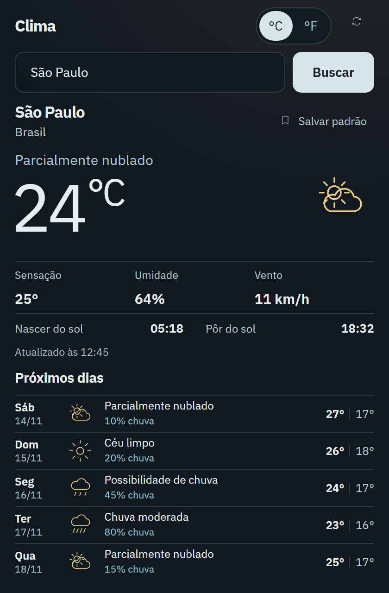
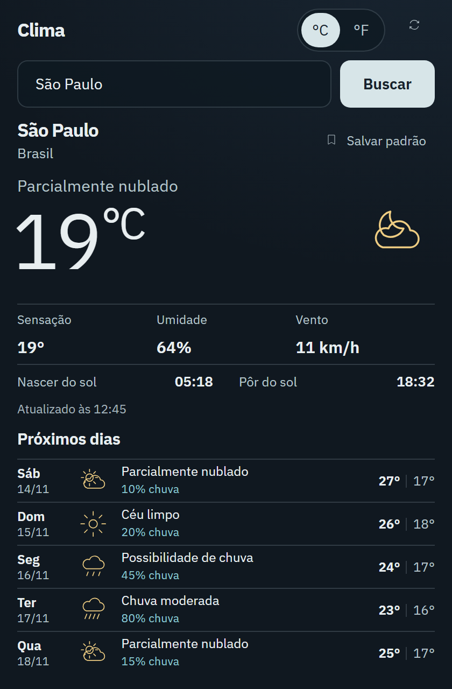
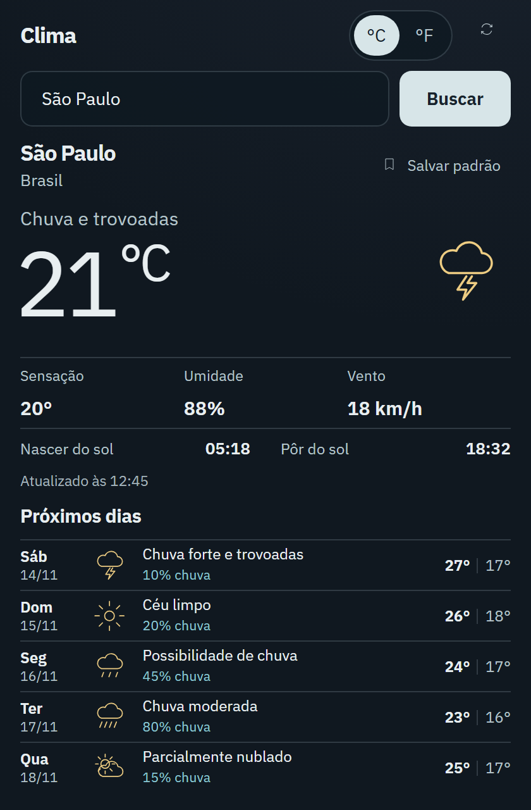

# Clima

Aplicativo desktop para acompanhar o clima atual e a previsão da sua cidade.


## Capturas de tela

| Dia | Noite | Chuva |
| --- | --- | --- |
|  |  |  |

## Funcionalidades

- Busca de cidades e consulta do clima atual.
- Previsão para cinco dias, com máximas, mínimas e chance de chuva.
- Unidades em °C ou °F e opção para salvar uma cidade padrão.
- Atualização automática a cada 15 minutos.
- Atmosfera visual que acompanha o clima e o horário.
- Dados da Open-Meteo, sem necessidade de chave de API.

## Download

Baixe o instalador na página de [Releases](https://github.com/Pavwos/weather-rust/releases). O arquivo tem o formato `Clima_X.Y.Z_x64-setup.exe`.

Como o aplicativo não é assinado digitalmente, o Windows pode exibir o aviso “O Windows protegeu seu PC”. Para continuar, clique em **Mais informações** e depois em **Executar assim mesmo**.

## Pré-requisitos

- Windows 10 ou 11 com o WebView2 Runtime (normalmente já instalado).
- Rust e a toolchain MSVC do Visual Studio Build Tools.
- Node.js LTS e npm.

## Desenvolvimento

Na raiz do projeto:

```sh
npm install
npm run tauri dev
```

## Gerar o aplicativo

```sh
npm run tauri build
```

No Windows, o executável fica em `src-tauri/target/release/clima.exe`. O instalador NSIS fica em `src-tauri/target/release/bundle/nsis/`.

## Configuração

As preferências incluem cidade padrão, última cidade pesquisada e unidade. No Windows, ficam em `%APPDATA%\weather-cli\config.toml`.

As chamadas de geocodificação e previsão usam a Open-Meteo e precisam de conexão com a internet. A interface e os recursos visuais são empacotados localmente.

## Tecnologias

- Rust
- Tauri v2
- TypeScript
- Vite
- Open-Meteo
- IBM Plex Sans

## Créditos

- [Open-Meteo](https://open-meteo.com/): dados meteorológicos.
- IBM Plex Sans: fonte sob a licença [SIL Open Font License 1.1 (OFL)](src-tauri/resources/IBM-Plex-Sans-LICENSE.txt).
